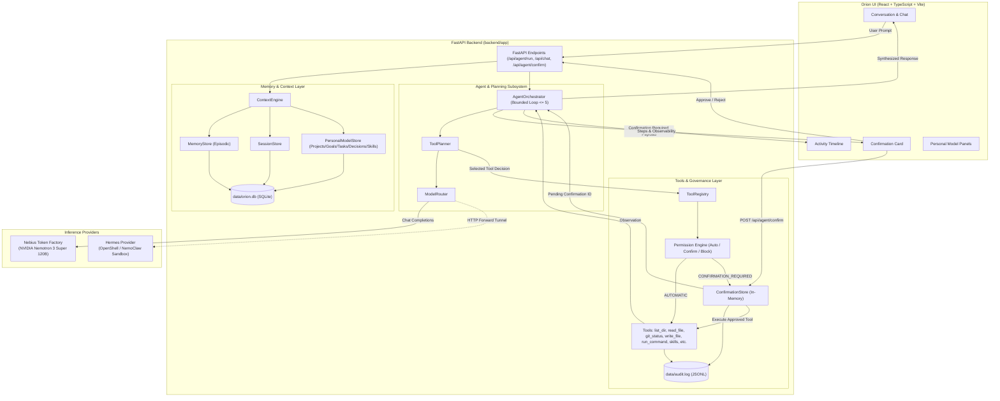

# Orion — Your Personal AI Operating Layer

> “A personal AI that remembers your work, reuses skills, and executes tasks with explicit permission boundaries.”

Orion is a local-first personal AI operating layer built for developers and knowledge workers. SQLite database storage, session histories, personal models, and workspace operations are managed locally on your machine, while model reasoning is performed by sending prompts and relevant context to the configured cloud inference provider, Nebius Token Factory. It bridges the gap between raw language models and real workspace execution by pairing persistent memory and structured personal context with a bounded multi-step agent orchestrator and an explicit three-tier permission model.

Orion was developed for the **Nebius x NVIDIA Global AI Hackathon 2026**, powered by **NVIDIA Nemotron** inference served through the **Nebius Token Factory**.

---

## Table of Contents

- [1. Project Overview & Problem Statement](#1-project-overview--problem-statement)
- [2. What Makes Orion Different](#2-what-makes-orion-different)
- [3. Core Implemented Features](#3-core-implemented-features)
- [4. Architecture & Request Flow](#4-architecture--request-flow)
- [5. Technology Stack](#5-technology-stack)
- [6. Orion Implementation vs. Integrated Infrastructure](#6-orion-implementation-vs-integrated-infrastructure)
- [7. Nebius Token Factory & NVIDIA Nemotron Configuration](#7-nebius-token-factory--nvidia-nemotron-configuration)
- [8. Hermes Agent & NemoClaw / OpenShell Relationship](#8-hermes-agent--nemoclaw--openshell-relationship)
- [9. Prerequisites & Setup Guide](#9-prerequisites--setup-guide)
- [10. Environment Configuration](#10-environment-configuration)
- [11. Testing Suites & Verification Commands](#11-testing-suites--verification-commands)
- [12. Walkthrough Demo Workflow](#12-walkthrough-demo-workflow)
- [13. Security Boundaries & Current Limitations](#13-security-boundaries--current-limitations)
- [14. Hackathon Track Alignment & Attribution](#14-hackathon-track-alignment--attribution)
- [15. Project Roadmap](#15-project-roadmap)
- [16. License](#16-license)

---

## 1. Project Overview & Problem Statement

Modern AI coding assistants and generic conversational chatbots suffer from two fundamental disconnects:

1. **Amnesia & Context Blindness:** Each session begins as a blank slate. Chatbots forget project architecture, personal goals, completed milestones, and previously settled design decisions, forcing developers to repeatedly re-explain context.
2. **The Autonomy Paradox:** Existing tools either act as passive text generators with zero execution agency, or as unconstrained autonomous scripts that can execute destructive filesystem and shell mutations without granular human consent.

**Orion solves this by introducing a personal operating layer:**
- A **structured Personal Model** stored locally in SQLite that explicitly tracks projects, goals, tasks, decisions, and reusable skills.
- An **episodic memory store** that remembers facts and preferences across conversations.
- A **context engine** that dynamically injects relevant project state and memory into model prompts inside delimited XML blocks designed to mitigate prompt injection.
- A **bounded multi-step agent orchestrator** that can inspect files and run diagnostic commands.
- An **enforced permission boundary** where mutating actions (file writes, deletes, command runs, project/task mutations) halt execution and require explicit user authorization before execution.

---

## 2. What Makes Orion Different

| Capability | Generic Chatbots | Unconstrained Autonomous Agents | Orion Personal AI |
| :--- | :--- | :--- | :--- |
| **Workspace Context** | Ephemeral, manually pasted | Ad-hoc scraping without governance | Bounded, structured local SQLite model (`projects`, `goals`, `tasks`, `decisions`) |
| **Long-Term Memory** | None (session only) | Opaque vector blobs without user controls | Categorized episodic memory with importance weighting and user inspection/deletion |
| **Skill Reusability** | None | Prompt snippets | Validated multi-step workflows (`create_skill`, `use_skill`) with programmatic validation checks |
| **Tool Execution** | Read-only or none | Arbitrary unconstrained shell execution | Allowlisted executables (`git`, `python`), no raw shell invocation (`shell=False`) |
| **Safety & Governance** | Not applicable | Prompts asking for forgiveness after actions | Enforced 3-tier permissions (`AUTOMATIC`, `CONFIRMATION_REQUIRED`, `BLOCKED`) |
| **Human-in-the-Loop** | Manual copy-pasting | Often bypassed or all-or-nothing | Interactive confirmation cards with unique IDs and immutable argument inspection |
| **Auditability** | None | Raw terminal dumps | Sanitized, secret-scrubbed JSONL audit log (`data/audit.log`) |
| **Privacy & Locality** | Cloud-stored conversations | Cloud-stored session logs | Local SQLite database and workspace boundaries; prompts and context sent to cloud inference (Nebius Token Factory) |

---

## 3. Core Implemented Features

Every feature listed below is verified in the Orion source tree:

### Personal Model Knowledge Layer
- **Structured SQLite Schemas:** Dedicated tables with foreign key constraints for `projects`, `goals`, `tasks`, `decisions`, and `skills` ([`backend/app/memory/personal.py`](backend/app/memory/personal.py)).
- **Project Tracking:** Status management (`active`, `paused`, `completed`, `archived`) with repository and directory metadata.
- **Goal & Task Management:** Task hierarchy with status (`todo`, `pending`, `in_progress`, `blocked`, `completed`, `cancelled`) and priority tiers (`low`, `medium`, `high`, `urgent`).
- **Architectural Decision Records:** Explicit `record_decision` facility capturing architectural context linked to projects.
- **Snapshot Service:** `PersonalModelService.get_personal_snapshot()` produces bounded representations to avoid context flooding.

### Persistent Memory & Context Engine
- **Episodic Memory Store:** SQLite-backed key-value and categorized memory with importance ratings (1–5) and keyword recall ([`backend/app/memory/store.py`](backend/app/memory/store.py)).
- **Session & History Store:** Relational conversation session manager with foreign-key message history ([`backend/app/memory/session.py`](backend/app/memory/session.py)).
- **Context Injection Guardrails:** `ContextEngine` formats personal model state and episodic memories into delimited `<personal_model>` and `<episodic_memory>` blocks, backed by system instructions ensuring memories cannot override security constraints ([`backend/app/memory/context.py`](backend/app/memory/context.py)).

### Reusable Skills Engine
- **Validated Multi-Step Workflows:** Store multi-step sequences of registered Orion tools in JSON format ([`backend/app/tools/skills/service.py`](backend/app/tools/skills/service.py)).
- **Skill Validator:** Enforces bounded step limits (1–10 steps), registered tools only, and bans recursive agent calls, nested skills, arbitrary code patterns, SQL injection, and shell operators ([`backend/app/tools/skills/validator.py`](backend/app/tools/skills/validator.py)).
- **Safe Step Execution:** `UseSkillTool` executes automatic steps sequentially but immediately halts and requests user confirmation if any step encounters a `CONFIRMATION_REQUIRED` tool ([`backend/app/tools/skills/tools.py`](backend/app/tools/skills/tools.py)).

### Safe Workspace Tool Suite
- **Directory & File Inspection:** `list_directory` and `read_file` constrained to the workspace root using `safe_path()` checks ([`backend/app/tools/filesystem.py`](backend/app/tools/filesystem.py)).
- **Git Repository Inspection:** `git_status` provides structured branch, staged, unstaged, and untracked status without shell execution ([`backend/app/tools/git.py`](backend/app/tools/git.py)).
- **Protected File Filtering:** Programmatic rejection of access to secret and environment files (`.env*`, `credentials*`, `id_rsa*`, `*.key`, `*.pem`) via `is_protected_file()` ([`backend/app/tools/workspace.py`](backend/app/tools/workspace.py)).
- **Allowlisted Command Execution:** `run_command` executes allowlisted binaries (`git`, `python`, `python3`) with `shell=False`. Git is limited to read-only subcommands (`status`, `diff`, `log`, `branch`, `show`). Python is restricted to `--version`, `-m unittest`, and `-m pytest` ([`backend/app/tools/command.py`](backend/app/tools/command.py)).

### Security, Governance & Audit Logging
- **Three-Tier Permission Engine:** Explicit categorization (`AUTOMATIC`, `CONFIRMATION_REQUIRED`, `BLOCKED`) enforced by `ToolRegistry` ([`backend/app/tools/permissions.py`](backend/app/tools/permissions.py)).
- **Confirmation Store:** Issues unique confirmation tokens (`conf_<hex>`) and preserves immutable argument payloads awaiting user approval ([`backend/app/tools/confirmation.py`](backend/app/tools/confirmation.py)).
- **Secret Scrubbing & Audit Trail:** `log_event()` writes timestamped, sanitized JSONL entries to `data/audit.log`. API keys, tokens, authorization headers, and raw file contents are automatically scrubbed or redacted ([`backend/app/tools/audit.py`](backend/app/tools/audit.py)).

### User Interface & Observability
- **Modern Responsive UI:** React 18, TypeScript, Tailwind CSS, and Lucide icons ([`frontend/src/App.tsx`](frontend/src/App.tsx)).
- **Agent Activity Timeline:** Visual step-by-step breakdown of agent planning, tool invocations, parameters, and observation results ([`frontend/src/components/agent/ActivityTimeline.tsx`](frontend/src/components/agent/ActivityTimeline.tsx)).
- **Interactive Confirmation Cards:** In-conversation approval cards with operation summaries, parameter previews, and one-click Approve/Reject actions ([`frontend/src/components/conversation/ConfirmationCard.tsx`](frontend/src/components/conversation/ConfirmationCard.tsx)).
- **Personal Knowledge Panels:** Dedicated views for Projects, Goals, Tasks, Skills, Memory, and Settings ([`frontend/src/components/personal/`](frontend/src/components/personal/)).

---

## 4. Architecture & Request Flow



### Request Flow Walkthrough

1. **User Request Received:** The user submits a prompt via the Orion UI (or `POST /api/agent/run`).
2. **Context Compilation:** `ContextEngine` queries `data/orion.db` for relevant episodic memories, active projects, goals, tasks, decisions, and saved skills. It formats these into delimited XML blocks injected into the system prompt.
3. **Bounded Orchestrator Loop:** `AgentOrchestrator` initializes a loop bounded to a maximum of 5 iterations.
4. **Tool Planning:** `ToolPlanner` formats the prompt with available tool definitions and prior observations, invoking the configured provider (`nvidia/nemotron-3-super-120b-a12b` via Nebius Token Factory).
5. **Decision Branching:**
   - **Direct Response:** If the model selects `respond`, it produces a direct answer. If tools were previously executed, it synthesizes an answer grounded in accumulated tool observations.
   - **Automatic Tool:** If an automatic tool is chosen (`list_directory`, `read_file`, `git_status`, `use_skill`), `ToolRegistry` executes it within workspace boundaries, logs the action to `data/audit.log`, records the observation, and continues the loop.
   - **Confirmation Required:** If a mutating tool is chosen (`write_file`, `delete_file`, `run_command`, `update_project`, `update_task`, `record_decision`, `create_skill`), the loop halts immediately. A `PendingConfirmation` record is stored in `ConfirmationStore`, and the agent returns a confirmation payload to the UI.
6. **User Confirmation Interaction:** The UI renders an interactive `ConfirmationCard`. The user can inspect the exact tool arguments and choose **Approve Action** or **Reject**.
7. **Approved Execution:** On approval (`POST /api/agent/confirm`), the tool executes with the exact verified arguments, records the outcome to `data/audit.log`, and updates the session conversation.

---

## 5. Technology Stack

### Backend
- **Framework:** FastAPI 0.115+ (ASGI web application framework)
- **Server:** Uvicorn with standard workers
- **Language:** Python 3.12+
- **Validation & Settings:** Pydantic v2 & Pydantic-Settings
- **Storage:** SQLite3 with foreign-key constraints enabled
- **HTTP Client:** HTTPX (async client for inference provider requests)
- **Testing:** Pytest & Python standard library `unittest`

### Frontend
- **Framework:** React 18.3
- **Language:** TypeScript 5.6
- **Build Tool:** Vite 6.0
- **Styling:** Tailwind CSS 3.4 & PostCSS
- **Icons:** Lucide React
- **Component Testing:** Vitest 2.1 & React Testing Library with JSDOM

### Infrastructure & Inference
- **Primary Model Provider:** Nebius Token Factory
- **Primary LLM:** NVIDIA Nemotron (`nvidia/nemotron-3-super-120b-a12b`)
- **Secondary / Sandbox Provider:** Hermes Agent (OpenAI-compatible HTTP service via OpenShell gateway tunnel)

---

## 6. Orion Implementation vs. Integrated Infrastructure

To maintain complete architectural clarity, here is what Orion implements versus the external platforms it integrates with:

### Implemented by Orion (In This Codebase)
- **Operating Layer & Web API:** FastAPI application endpoints, routing, error handling, and request/response models.
- **Local Persistence & Personal Model:** Relational SQLite schemas for projects, goals, tasks, decisions, skills, episodic memories, and session histories.
- **Context Engine:** Deterministic XML context construction and prompt injection mitigations.
- **Multi-Step Agent Orchestrator:** Bounded 5-step agent execution loop with repeated-call prevention, inspection completion state tracking, and synthesis.
- **Tool Suite & Permission Engine:** 12 native tools, 3-tier permission governance, workspace root sandbox (`safe_path`), and protected file filters.
- **Governance & Audit Trail:** Interactive human-in-the-loop confirmation store and automated secret-scrubbed JSONL audit logging.
- **User Interface:** Full React single-page application with conversational workspace, personal model management panels, activity timelines, and confirmation modals.

### External Infrastructure Integrated With
- **Nebius Token Factory:** Cloud-hosted inference gateway providing token generation for open-weights models via standard HTTP REST APIs.
- **NVIDIA Nemotron:** The underlying instruction-tuned model (`nvidia/nemotron-3-super-120b-a12b`) running on Nebius infrastructure.
- **OpenShell / NemoClaw Sandbox:** External sandboxing platform providing container isolation and gRPC forwarding tunnels for the Hermes Agent runtime.

---

## 7. Nebius Token Factory & NVIDIA Nemotron Configuration

Orion integrates directly with the **Nebius Token Factory** using its OpenAI-compatible endpoint.

### Model Details
- **Default Model Identifier:** `nvidia/nemotron-3-super-120b-a12b`
- **Default Base URL:** `https://api.tokenfactory.nebius.com/v1`
- **Implementation File:** [`backend/app/providers/nebius.py`](backend/app/providers/nebius.py)

### How It Works in Code
1. `NebiusProvider` reads `nebius_api_key`, `nebius_base_url`, and `nebius_model` from application settings ([`backend/app/config.py`](backend/app/config.py)).
2. Requests are sent asynchronously via `httpx.AsyncClient.post()` to `{nebius_base_url}/chat/completions`.
3. Calls are governed by a configurable timeout (`model_timeout_seconds`, default: 60.0s).
4. The Bearer token is injected via request headers and is scrubbed from error logs, exceptions, and audit trails.

---

## 8. Hermes Agent & NemoClaw / OpenShell Relationship

Orion includes architectural support and an adapter for the **Hermes Agent** operating inside an **OpenShell / NemoClaw** sandbox.

### Communication Architecture
```
Orion (Host Python Process)
  └── HTTP POST http://127.0.0.1:8642/v1/chat/completions
        Bearer: <HERMES_GATEWAY_TOKEN>
          └── [OpenShell gRPC forward service tunnel]
                └── sandbox:8642 (Hermes Agent OpenAI-compatible REST API)
```

### Verified Runtime Behavior vs. Planned Setup

| Aspect | Verified in Current Codebase | Planned / External Prerequisite |
| :--- | :--- | :--- |
| **Provider Adapter** | `HermesProvider` is fully implemented in [`backend/app/providers/hermes.py`](backend/app/providers/hermes.py) | Requires external OpenShell container runtime |
| **Routing Integration** | Registered in `ModelRouter` and exposed via `GET /api/providers` | Dynamic discovery of running sandbox status |
| **UI Model Selection** | Provider selector dropdown in UI Header supports `nebius` and `hermes` | Automated health ping indicator for Hermes tunnel |
| **Token Handling** | `HERMES_GATEWAY_TOKEN` injected via `.env`, validated at call time, scrubbed from logs | Automatic gateway token generation via CLI |
| **Unit Verification** | Comprehensive unit test suite ([`backend/tests/test_hermes.py`](backend/tests/test_hermes.py)) mocks HTTP transport and verifies headers, payload formatting, error handling, and token protection | Live end-to-end sandbox execution during user turns |

If `HERMES_GATEWAY_TOKEN` is not configured, Orion gracefully defaults to `nebius` and raises a clear error only if `hermes` is explicitly requested.

---

## 9. Prerequisites & Setup Guide

### System Prerequisites
- **Linux** (tested on Ubuntu 22.04+) or **macOS**
- **Python 3.12+**
- **Node.js 18+** and **npm 9+**
- **Git**

### 1. Clone the Repository
```bash
git clone https://github.com/ssurekumar01111-hue/orion-personal-ai.git
cd orion-personal-ai
```

### 2. Backend Setup
Create and activate a Python virtual environment, then install backend dependencies:

```bash
# In the repository root
python3 -m venv .venv
source .venv/bin/activate

# Install backend dependencies
pip install -r backend/requirements.txt
```

### 3. Frontend Setup
Install frontend dependencies:

```bash
# In the frontend directory
cd frontend
npm install
cd ..
```

### 4. Running the Application

You will need two terminal sessions (one for the backend, one for the frontend):

**Terminal 1 — Backend (FastAPI):**
```bash
# Option A: From repository root
source .venv/bin/activate
PYTHONPATH=backend uvicorn app.main:app --reload --port 8000

# Option B: From the backend directory
cd backend
source ../.venv/bin/activate
uvicorn app.main:app --reload --port 8000
```
The backend will initialize the SQLite database at `data/orion.db` and start listening at `http://127.0.0.1:8000`.

**Terminal 2 — Frontend (Vite Dev Server):**
```bash
cd frontend
npm run dev
```
The frontend dev server will launch at `http://localhost:5173`. Requests to `/api` and `/health` are automatically proxied to the backend on port 8000.

---

## 10. Environment Configuration

Create a `.env` file in the repository root (`~/orion/.env`).

> [!IMPORTANT]
> Never commit `.env` files or share API tokens. The Orion workspace guardrail is configured to reject agent read or modification attempts for any file matching `.env*`.

### Configuration Variables

| Variable Name | Required | Default Value | Description |
| :--- | :--- | :--- | :--- |
| `NEBIUS_API_KEY` | **Yes** | *(None)* | API Key for Nebius Token Factory inference. |
| `NEBIUS_BASE_URL` | No | `https://api.tokenfactory.nebius.com/v1` | Nebius API endpoint. |
| `NEBIUS_MODEL` | No | `nvidia/nemotron-3-super-120b-a12b` | Model name on Nebius Token Factory. |
| `HERMES_GATEWAY_TOKEN` | Optional | `""` | Bearer token for the OpenShell forward gateway. |
| `HERMES_BASE_URL` | No | `http://127.0.0.1:8642/v1` | URL of the local OpenShell gateway tunnel. |
| `HERMES_MODEL` | No | `hermes-agent` | Model identifier exposed by the Hermes agent. |
| `MODEL_TIMEOUT_SECONDS` | No | `60.0` | HTTP request timeout for LLM provider completions. |
| `ORION_DATABASE_PATH` | No | `data/orion.db` | Custom path override for the SQLite database. |

### Example `.env` Template
```ini
# Nebius Token Factory
NEBIUS_API_KEY=your_nebius_api_key_here
NEBIUS_BASE_URL=https://api.tokenfactory.nebius.com/v1
NEBIUS_MODEL=nvidia/nemotron-3-super-120b-a12b

# Optional: Hermes Agent / OpenShell Sandbox
HERMES_GATEWAY_TOKEN=
HERMES_BASE_URL=http://127.0.0.1:8642/v1
HERMES_MODEL=hermes-agent

# Timeout & Runtime Configuration
MODEL_TIMEOUT_SECONDS=60.0
```

---

## 11. Testing Suites & Verification Commands

Orion includes comprehensive test suites covering both the backend Python services and the frontend React components.

### Backend Test Suite (Pytest)

The backend test suite uses an isolated test database (`data/orion_test.db`) initialized automatically by `backend/tests/__init__.py` to prevent polluting production state.

```bash
# Run all backend tests from the repository root
source .venv/bin/activate
pytest backend/tests

# Run a specific backend test module
pytest backend/tests/test_skills.py
pytest backend/tests/test_hermes.py
pytest backend/tests/test_tools.py
pytest backend/tests/test_planner.py
```

#### Verified Test Modules
- [`test_tools.py`](backend/tests/test_tools.py): Tests tool registry, filesystem operations, path jail, and protected file policies.
- [`test_run_command.py`](backend/tests/test_run_command.py): Verifies command allowlisting, shell wrapper rejection, and argument validation.
- [`test_personal_model.py`](backend/tests/test_personal_model.py): Tests SQLite repository CRUD for projects, goals, tasks, decisions, and skills.
- [`test_personal_mutation_tools.py`](backend/tests/test_personal_mutation_tools.py): Tests `update_project`, `update_task`, and `record_decision`.
- [`test_skills.py`](backend/tests/test_skills.py): Verifies skill validation, step limits, security checks, and execution halting on confirmation.
- [`test_planner.py`](backend/tests/test_planner.py): Tests tool planning prompts, schema validation, and code-fence stripping.
- [`test_multi_step.py`](backend/tests/test_multi_step.py): Verifies the 5-iteration bounded orchestrator loop, repeated call detection, and synthesis.
- [`test_hermes.py`](backend/tests/test_hermes.py): Validates `HermesProvider` headers, token isolation, and HTTP mock responses.
- [`test_integration.py`](backend/tests/test_integration.py): End-to-end ASGI test client runs testing real tool dispatch and audit logging.

### Frontend Test Suite (Vitest)

```bash
# In the frontend directory
cd frontend
npm test
```

#### Verified Frontend Test Modules
- [`agentActivity.test.tsx`](frontend/src/test/agentActivity.test.tsx): Tests rendering of the Activity Timeline, step icons, and argument expansions.
- [`chat.test.tsx`](frontend/src/test/chat.test.tsx): Tests conversation flow, message submission, and response rendering.
- [`confirmation.test.tsx`](frontend/src/test/confirmation.test.tsx): Tests interactive confirmation cards, approval buttons, and rejection flows.
- [`personalPanels.test.tsx`](frontend/src/test/personalPanels.test.tsx): Tests rendering and interaction with Projects, Goals, Tasks, and Memory panels.
- [`providerSelector.test.tsx`](frontend/src/test/providerSelector.test.tsx): Tests switching between Nebius and Hermes providers in the header.

---

## 12. Walkthrough Demo Workflow

The following scenario illustrates Orion's core design in action: inspecting a workspace, utilizing a reusable skill, reporting findings, and enforcing confirmation boundaries before any mutation occurs.

### Step 1: Project & Git Inspection (Automatic)
The developer opens Orion and enters:
> *"Inspect the repository files and tell me our current git status."*

1. **Planner Decision:** `ToolPlanner` identifies that inspection tools are required.
2. **Execution:** The agent invokes `list_directory(path=".")` and `git_status()`.
3. **Observation:** Both tools possess `AUTOMATIC` permissions and execute immediately without interrupting the user.
4. **Synthesis:** The agent synthesizes an accurate summary explaining the directory layout and confirming the branch status.

### Step 2: Creating or Selecting a Reusable Skill
Because Orion initializes with an unseeded skill store, skills are not pre-populated. The workflow begins by asking the user to create a new reusable skill or select an existing skill saved in the database.

The developer asks Orion to create a reusable skill:
> *"Save a reusable skill named 'test-runner' with steps to run git_status and python -m pytest backend/tests/test_tools.py."*

1. **Skill Creation & Confirmation:** `ToolPlanner` selects `create_skill`. Because saving a skill mutates the Personal Model, Orion pauses and requests confirmation. Once approved, the skill workflow is validated and recorded into the `skills` table in `data/orion.db`.

Next, the developer asks to execute the newly created skill (or selects it from existing skills):
> *"Run our test-runner skill to verify the tools."*

2. **Skill Lookup:** The agent invokes `use_skill(skill_name="test-runner")`.
3. **Step Traversal & Safety Halt:** The skill workflow contains two steps:
   - Step 1: `git_status` (`AUTOMATIC`) — executes immediately.
   - Step 2: `run_command(command="python", arguments=["-m", "pytest", "backend/tests/test_tools.py"])` (`CONFIRMATION_REQUIRED`).
4. `UseSkillTool` detects that Step 2 requires confirmation. Execution immediately pauses and reports:
   ```json
   {
     "status": "confirmation_required",
     "stopped_at_step": 2,
     "pending_tool": "run_command"
   }
   ```

### Step 3: Explicit Human-in-the-Loop Confirmation
1. **Interactive UI Card:** The Orion UI displays a `ConfirmationCard` with:
   - Tool Name: `run_command`
   - Command: `python -m pytest backend/tests/test_tools.py`
   - Confirmation ID: A unique runtime token (e.g., `conf_<hex>`). Orion generates a unique ID at runtime for each confirmation request rather than using a static identifier.
2. **User Authorization:** The user reviews the immutable argument parameters and clicks **Approve Action**.
3. **Execution & Audit Log:**
   - The backend validates the pending confirmation ID.
   - The command runs with `shell=False` in the workspace root.
   - The outcome is captured in `data/audit.log` (with scrubbed environment variables).
   - Test results are returned to the session timeline.

### Step 4: Recording a Structured Decision (Confirmation Required)
The developer states:
> *"Record our decision that all personal model tables will use SQLite with foreign keys enabled."*

1. **Planner Decision:** The agent calls `record_decision(decision="All personal model tables use SQLite with foreign keys enabled", context="Guarantees relational consistency and local developer data persistence")`.
2. **Confirmation Boundary:** Because `record_decision` mutates the Personal Model, Orion generates a confirmation request.
3. **Committed Record:** Once approved, the record is stored in the `decisions` table in `data/orion.db`.
4. **Subsequent Context Injection:** Future turns automatically incorporate this decision inside the `<personal_model>` system prompt block.

---

## 13. Security Boundaries & Current Limitations

### Security Boundaries
- **Workspace Confinement (`safe_path`):** All filesystem operations resolve relative to `WORKSPACE_ROOT`. Directory traversal sequences (`../../`) raise `PermissionError` and return HTTP 403.
- **Protected File Filtering (`is_protected_file`):** Reading, writing, or deleting `.env`, `.env.*`, credential files, SSH keys, or private certificates is rejected by programmatic path checks.
- **Command Filtering & No Arbitrary Shell:** `RunCommandTool` executes allowlisted binaries directly with `shell=False`. Shell wrappers (`bash`, `sh`, `zsh`, `cmd`, `powershell`) and chaining metacharacters (`;`, `&&`, `|`, `>`, `$()`) are rejected by policy validation.
- **Prompt Injection Mitigations:** Personal model entries and memories are injected inside delimited XML tags accompanied by explicit system policies instructing the model that context records cannot override tool permissions or system instructions. These prompt-injection defenses are mitigations and defense-in-depth measures, not an absolute guarantee against adversarial inputs.
- **Sanitized Audit Trail:** `data/audit.log` redacts API keys, tokens, authorization headers, and raw file contents (`<content omitted>`).

### Current Limitations
- **No Independent Security Audit:** The implemented safeguards, permission models, and injection defenses are software-level mitigations and have not undergone an independent third-party security audit.
- **Cloud Inference & Data Transmission:** While SQLite database storage, session histories, personal models, and workspace operations execute locally, prompts and relevant context are sent to the configured cloud inference provider (Nebius Token Factory) to generate model completions. Complete data locality would require pointing to a locally hosted LLM endpoint.
- **In-Memory Confirmation Store:** Pending confirmation IDs are stored in process memory (`ConfirmationStore._confirmations`). If the FastAPI server is restarted while a confirmation card is awaiting action, that confirmation ID becomes invalid and the request must be re-issued.
- **Single-User Local Deployment:** Orion is currently designed as a single-user personal operating layer on `localhost`; it does not yet include multi-tenant user authentication or row-level access control.
- **Bounded Synchronous Agent Turn:** The agent loop is bounded to 5 sequential iterations per user turn. It does not run as a detached, unconstrained background daemon.
- **Host Process Execution:** Allowlisted commands execute on the host machine within the workspace directory, rather than in an ephemeral Docker micro-container (which is the goal of the Hermes/NemoClaw integration).

---

## 14. Hackathon Track Alignment & Attribution

### Hackathon Track Alignment
Orion is developed for the **Nebius x NVIDIA Global AI Hackathon 2026** with an intended focus and alignment around **Personal AI Assistants and Agentic Workflows** (intended track / use case).

The project demonstrates:
- Practical deployment of open-weights models (**NVIDIA Nemotron**) for multi-step reasoning, tool planning, and synthesis.
- Leveraging **Nebius Token Factory** for cloud-hosted, OpenAI-compatible model inference.
- Designing safe agent operating architectures that pair model intelligence with deterministic, verifiable human-in-the-loop safety boundaries.

### Attributions
- **Nebius:** Cloud inference gateway providing access to NVIDIA Nemotron models via the Nebius Token Factory API.
- **NVIDIA:** Nemotron open-weights model architecture (`nvidia/nemotron-3-super-120b-a12b`) and the NemoClaw agent runtime ecosystem.

---

## 15. Project Roadmap

### Implemented Capabilities
- [x] Relational SQLite storage for episodic memory, sessions, and messages.
- [x] Structured Personal Model: Projects, Goals, Tasks, Decisions, and Skills.
- [x] ContextEngine with XML-delimited prompt injection defenses.
- [x] 12 registered tools across workspace, git, command, personal model, and skills.
- [x] 3-tier permission engine (`AUTOMATIC`, `CONFIRMATION_REQUIRED`, `BLOCKED`).
- [x] Bounded multi-step agent orchestrator (up to 5 iterations) with repeated-call prevention.
- [x] Nebius Token Factory integration (`nvidia/nemotron-3-super-120b-a12b`).
- [x] Hermes Agent provider adapter with gateway token isolation and unit test suite.
- [x] Interactive UI with Activity Timeline, Confirmation Cards, and Personal Knowledge Panels.
- [x] Sanitized JSONL audit logging with automated credential redaction.

### Planned (Future Checkpoints)
- [ ] **Persistent Confirmation Store:** Migrate pending confirmations from memory to SQLite so approvals survive server restarts.
- [ ] **Semantic Vector Memory:** Complement SQLite substring keyword matching with local vector embeddings for semantic episodic recall.
- [ ] **Automated NemoClaw Sandbox Lifecycle:** Launch and monitor OpenShell/NemoClaw containers directly from the Orion interface.
- [ ] **Remote Sync:** Bidirectional synchronization between Orion Projects/Tasks and GitHub Issues or Markdown roadmaps.
- [ ] **Background Task Queue:** Asynchronous task execution with streaming progress updates for long-running workflows.

---

## 16. License

This project is licensed under the **Apache License, Version 2.0**. See the [LICENSE](LICENSE) file for the complete license text.

Copyright 2026 Surendra Kumar.